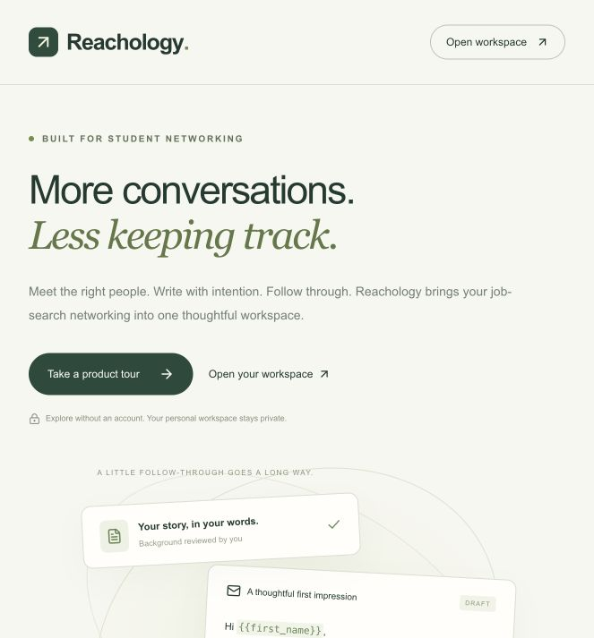

# Reachology

**A student networking workflow project — from a thoughtful introduction to a clear next action.**

Reachology helps college and graduate students organize outreach alongside applications, classes and interviews. The full product includes editable email templates, user-reviewed background variables, contact tracking and response analytics.

This repository contains the **public product showcase and its frontend source**. The GitHub Pages site is a browser-only portfolio presentation. It does not read a mailbox, store personal information or send emails. The backend implementation and private runtime configuration are not part of this repository.

## Links

- **Product tour:** https://jiaaochen1119.github.io/reachology/
- **Full workspace:** [Open the separately hosted application](https://reachology.jiaaochen1119.chatgpt.site/workspace). Sign-in is required; Gmail/Apollo features require account configuration.



## Explore the public tour

- Switch between background review, email templates and next actions.
- Edit cold-outreach and first-follow-up preview messages.
- Insert an availability variable and reset the illustrative message.
- Read the implementation status and current limitations.

All preview content is illustrative. Text edits remain in memory on the current page and disappear on refresh.

## Product decisions

1. **Review before personalization.** Resume text extraction suggests fields; the user reviews and chooses which fields may become email variables.
2. **One voice, multiple conversations.** Cold outreach and first follow-up have independent editable templates. Recipient previews expose missing variables before approval.
3. **Track people, not just email volume.** Response metrics deduplicate contacts and show sample sizes. Detected automatic replies are excluded from human-reply statistics.
4. **Keep public presentation separate from private records.** The public tour has no connection to saved workspace records.

## Implementation status

| Capability | Status |
| --- | --- |
| Public product page and browser-only interactive tour | Implemented in this repository |
| Resume text extraction and user approval | Implemented in separately hosted workspace |
| CSV import, editable templates, contact notes and next actions | Implemented in separately hosted workspace |
| Response rate, reply latency and grouping | Calculated from saved workspace activity |
| Gmail authorization, sending and manual thread sync | Implemented in workspace; live end-to-end validation pending account setup |
| Apollo search and explicit enrichment | Implemented in workspace; provider credentials and live validation pending |
| Unattended follow-up scheduling and continuous inbox sync | Not implemented |

Background extraction in the full workspace uses rule-based text parsing followed by user review.

## Repository structure

```text
src/PublicHome.tsx     Product narrative and interactive preview
src/public.css        Responsive visual design
src/main.tsx          Standalone React entry point
public/favicon.svg    Brand icon
.github/workflows/    Pages build and deployment workflow
```

## Run locally

Requires Node.js 22.13+.

```sh
npm ci
npm run dev
npm run build
npm run preview
```

The showcase uses React, TypeScript, Vite and Lucide icons. Relative asset paths support GitHub project URLs such as `https://jiaaochen1119.github.io/reachology/`.

## Deploy

The included [workflow](.github/workflows/pages.yml) builds and deploys on pushes to `main`. In **Settings → Pages**, select **GitHub Actions** as the source. The workflow's deployment job reports the published URL.

See [GitHub's Pages workflow documentation](https://docs.github.com/en/pages/getting-started-with-github-pages/using-custom-workflows-with-github-pages).
